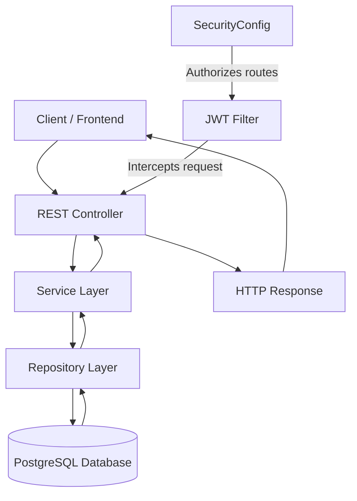

# BIS Project Architecture

## 1. Overview

BIS is a Spring Boot-based Billing and Inventory System built for managing products, services, users, inventory, dues, and bills. The application follows a layered architecture with separation between REST controllers, business services, repositories, and persistence models.

The system is centered on a Java 21 Spring Boot 4 application, uses PostgreSQL as the data store, and secures endpoints with JWT-based authentication.

---

## 2. Architectural Style

This project follows a classic Spring Boot layered design:

- Presentation Layer: REST controllers for auth, products, bills, inventory, services, users, and dashboard
- Application Layer: business logic services such as `AuthService`, `ProductService`, `BillService`, `InventoryService`, `UserService`
- Persistence Layer: Spring Data JPA repositories for database access
- Security Layer: JWT filter and Spring Security configuration
- Data Access / Storage: PostgreSQL with Flyway migration support

---

## 3. Technology Stack

- Java 21
- Spring Boot 4.1.0
- Spring Web
- Spring Data JPA
- Spring Security
- JWT (jjwt)
- PostgreSQL
- Flyway
- Lombok
- SpringDoc OpenAPI / Swagger UI
- Maven

---

## 4. High-Level Package Structure

```text
src/main/java/com/proto/BIS/
├── BisApplication.java
├── Billing/
│   ├── Controller/
│   ├── DTO/
│   ├── Model/
│   ├── Repository/
│   └── Service/
└── common/
    ├── Config/
    ├── Controller/
    ├── DTO/
    ├── Exception/
    ├── Model/
    ├── Repository/
    ├── Security/
    └── Service/
```

### Main responsibilities

- `Billing/`: billing-specific domain logic, bill creation, dues, bill history, bill item processing
- `common/`: shared infrastructure for login, auth, product management, inventory, users, services, and security-related classes

---

## 5. Domain Modules

### 5.1 Common module

The `common` package contains reusable system functions:

- `Controller/`: `AuthController`, `ProductController`, `InventoryController`, `UserController`, `ServiceController`, `DashboardController`, `LoginController`
- `Service/`: business services for authentication, inventory, product, login, user, and work/service operations
- `Repository/`: JPA repositories such as `UserRepo`, `ProductRepo`, `LoginRepo`, `WorkRepo`, `ServiceProductRepository`
- `Model/`: core domain entities such as `ProductModel`, `UserModel`, `ServicesModel`, `ServiceProduct`, etc.
- `Security/`: `SecurityConfig`, `JwtFilter`, authentication and authorization setup
- `Exception/`: `GlobalExceptionHandler` for centralized exception handling

### 5.2 Billing module

The billing feature is separated into its own module:

- `Billing/Controller/`: `BillController`, `DuesController`
- `Billing/Service/`: `BillService`, `DueService`
- `Billing/Repository/`: `BillRepo`, `BillItemRepo`, `DuesRepo`
- `Billing/Model/`: `Bills`, `BillItemModel`, `DuesModel`
- `Billing/DTO/`: request/response data transfer objects for bills and bill items

This separation makes the billing lifecycle independent from the general business modules while still sharing common product and user entities.

---

## 6. Request Flow



### Example login flow

1. Client sends credentials to `/api/auth/login`
2. `AuthController` receives the request
3. `AuthService` validates user credentials
4. A JWT token is generated and returned to the client
5. Subsequent requests include the token in the `Authorization` header
6. `JwtFilter` validates the JWT
7. The request is allowed or rejected based on the security rules in `SecurityConfig`

---

## 7. Security Architecture

The application uses Spring Security with stateless session management.

### Security configuration highlights

- CSRF is disabled
- CORS is enabled for the frontend origin (`http://localhost:5173`)
- JWT-based authentication is inserted before the standard username/password authentication filter
- Public endpoints include:
  - `/api/auth/**`
  - `/swagger-ui/**`
  - `/v3/api-docs/**`
  - `/api/bill/**`
- Sensitive endpoints require authentication:
  - `/api/dues/**`
  - `/api/product/**`
  - `/api/service/**`
  - `/api/inventory/**`
  - `/api/User/**`

Password hashing is handled with `BCryptPasswordEncoder`.

---

## 8. Persistence and Database Design

### Database layer

- Database: PostgreSQL
- Persistence: Spring Data JPA
- Schema management: Flyway migration scripts under `src/main/resources/db/migration/`

Current migrations include:

- `V1__init_schema.sql`
- `V2__service_product.sql`

The application is configured with `spring.jpa.hibernate.ddl-auto=validate`, meaning the schema is expected to match the database structure already defined by migrations.

---

## 9. Business Logic Patterns

### Transactional services

Key service classes are annotated with `@Service` and use transactional boundaries where required.

Example patterns:

- `BillService.createBill(...)` creates a bill, validates product/service stock, updates quantities, applies discount/GST, and creates due records if applicable
- `ProductService` handles CRUD-style inventory product operations
- `InventoryService` provides inventory-specific workflows

This keeps business rules close to the domain entities and away from controllers.

---

## 10. Exception Handling

The project centralizes error handling through `GlobalExceptionHandler` under `common/Exception`.

This ensures that controller-level exceptions are converted into consistent API responses rather than leaking raw database or server errors to clients.

---

## 11. API Documentation

Swagger/OpenAPI support is included through `springdoc-openapi-starter-webmvc-ui`.

This allows API endpoints to be browsed at:

- Swagger UI: `/swagger-ui/index.html`
- OpenAPI docs: `/v3/api-docs`

---

## 12. Deployment and Runtime Configuration

The main runtime configuration is in `src/main/resources/application.properties`.

Important runtime values:

- App name: `BIS`
- PostgreSQL datasource URL: default `jdbc:postgresql://localhost:5432/demodb`
- Default username/password: `postgres` / `qwerty`
- JWT secret: configurable via `JWT_SECRET`
- Flyway: currently disabled (`spring.flyway.enabled=false`)

This means database initialization is expected to be handled externally or by migrations being applied manually in the target environment.

---

## 13. Architectural Summary

The project is a modular, REST-first enterprise-style backend with:

- a clear controller → service → repository separation
- JWT-based stateless security
- PostgreSQL-backed persistence
- a billing-focused domain module and shared common infrastructure module
- centralized exception handling and OpenAPI documentation

This architecture is suitable for a business backend that needs inventory tracking, user authentication, service/product linking, billing generation, and due management.

---

## 14. Suggested Future Improvements

- Split common services further into domain-specific modules for better ownership boundaries
- Add more unit/integration tests for service layer behavior
- Introduce DTO validation and custom exception types for domain errors
- Turn on Flyway for automatic schema migration in all environments
- Add audit logging and role-based authorization for admin/staff flows
